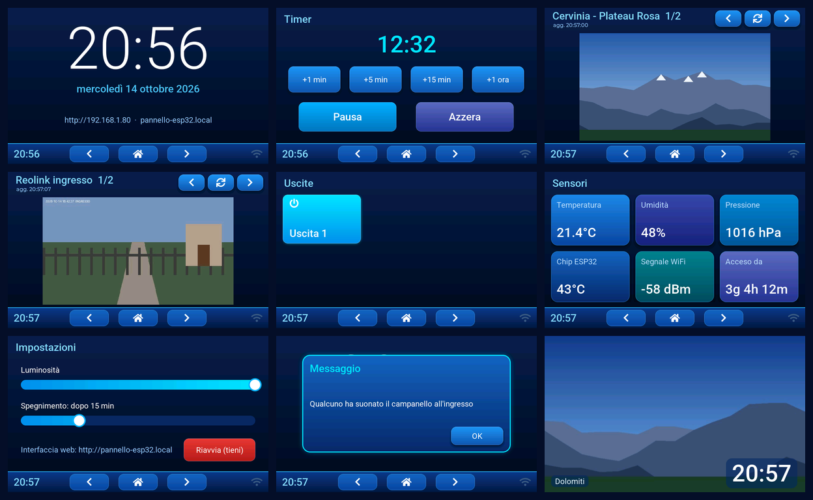

# Pannello touch ESP32 multi-pagina — CrowPanel 7"

Firmware ESPHome per l'**Elecrow CrowPanel 7.0" (DIS08070H)**: un pannello
touch da parete/scrivania per vari usi, **autonomo**. Non serve Home
Assistant né altri server: si usa dallo schermo e da qualunque browser della
rete di casa. Home Assistant e MQTT sono moduli facoltativi da attivare con
una riga.



*Anteprima generata compilando lo stesso firmware per PC (display simulato,
dati e immagini d'esempio). Le singole pagine sono in `docs/anteprima/`.*

## Cosa fa

Le pagine scorrono con la barra in basso (◀ · Home · ▶, dopo l'ultima si
torna alla prima). Ogni pagina è un file a sé: per toglierne una basta
commentare una riga.

| Pagina | Contenuto |
|---|---|
| **Home** | orologio grande, data in italiano, indirizzo web del pannello |
| **Timer** | conto alla rovescia con +1/+5/+15 min/+1 ora, avvia/pausa, azzera; a fine corsa mostra un avviso |
| **Webcam** | webcam di montagna (o qualunque immagine da internet), una alla volta, aggiornate ogni 10 min |
| **Telecamere** | telecamere di casa EZVIZ e Reolink, aggiornate ogni 3 s mentre la pagina è aperta |
| **Uscite** | pulsante grande per un relè su GPIO38 (espandibile con scheda relè I2C) |
| **Sensori** | temperatura/umidità/pressione (BME280 facoltativo), temperatura chip, segnale WiFi, tempo di accensione |
| **Impostazioni** | luminosità, spegnimento automatico dello schermo, riavvio |

Sempre presenti, su ogni pagina:
- **barra in basso** con l'ora e l'icona WiFi (bianca = connesso);
- **riquadro "Messaggio"**: scrivi un testo nell'entità *Messaggio* (dal
  browser, da Home Assistant, da MQTT o dal timer) e compare sopra la
  pagina corrente, riaccendendo lo schermo. Si chiude con OK.
- **salvaschermo**: dopo 60 s senza tocchi copre lo schermo con foto prese
  da un elenco di siti (una ogni 60 s), con l'ora grande in basso; un tocco
  lo chiude senza premere niente sotto. Tempi regolabili dal browser
  (*Salvaschermo dopo*, *Salvaschermo cambio immagine*; 0 = disattivato).
- **spegnimento schermo** dopo N secondi senza tocchi (default 15 min, 0 =
  mai): si spegne la retroilluminazione e si fermano i download; il primo
  tocco riaccende.

Tutto ciò che si vede sullo schermo (uscite, timer, sensori, luminosità,
messaggio) è comandabile anche da `http://pannello-esp32.local`.

## Struttura

```
esp32-panel/
├── esphome/
│   ├── esp32-panel.yaml          file principale: scheda, pagine, integrazioni
│   ├── secrets.yaml.example      copialo in secrets.yaml (ignorato da git)
│   ├── hardware/
│   │   ├── crowpanel-7-base.yaml    display, PSRAM, I2C, retroilluminazione
│   │   ├── crowpanel-7-v3.yaml      touch per la revisione V3.x (default)
│   │   └── crowpanel-7-v1v2.yaml    touch per le revisioni V1.x/V2.x
│   ├── pages/                    una pagina per file
│   │   ├── home.yaml  timer.yaml  uscite.yaml  sensori.yaml  impostazioni.yaml
│   │   └── immagini.yaml         modello usato da Webcam e Telecamere
│   ├── funzioni/
│   │   └── salvaschermo.yaml     salvaschermo con immagini da internet
│   └── integrations/             facoltative
│       ├── homeassistant.yaml
│       └── mqtt.yaml
└── tools/
    ├── trova-scheda.py           identifica la scheda collegata via USB
    └── trova-telecamere.py       elenca le telecamere EZVIZ/Reolink in rete
```

## Installazione

1. Installa ESPHome sul PC: `pip install esphome` (oppure usa l'add-on
   ESPHome o la dashboard Docker).
2. `cd esp32-panel/esphome && cp secrets.yaml.example secrets.yaml` e
   metti WiFi e password.
3. **Revisione della scheda**: è stampata sul retro (V1.0, V2.0, V3.0…). Il
   default è la V3; per V1/V2 in `esp32-panel.yaml` scambia le due righe
   `hardware:`. Se non la trovi, lascia V3, avvia e guarda il log: la
   scansione I2C deve mostrare `0x18` (l'espansore I/O della V3). Se manca,
   è una V1/V2.
4. Collega il pannello via USB e lancia `esphome run esp32-panel.yaml`
   (la prima compilazione scarica il toolchain e i font: qualche minuto).
   Se non si collega: tieni premuto **BOOT**, premi **RST**, rilascia BOOT.
5. Gli aggiornamenti successivi vanno via WiFi con lo stesso comando.

Senza WiFi raggiungibile il pannello crea la rete `Pannello-ESP32`
(password `ap_password` dei secrets) per riconfigurarlo dal browser.

`tools/trova-scheda.py` (`pip install esptool pyserial`) trova la porta
seriale e stampa chip, flash, PSRAM e il log di avvio: utile per capire cosa
c'è sulla scheda prima di flashare.

## Webcam, telecamere e salvaschermo: gli elenchi

Tutte e tre mostrano immagini scaricate da un URL. L'URL deve restituire
**direttamente un'immagine JPEG o PNG**, non una pagina web: apri la webcam
nel browser, tasto destro sull'immagine → *Copia indirizzo immagine*. I JPEG
"progressivi" non sono leggibili dall'ESP32 (lo script delle telecamere li
segnala). Gli elenchi sono liste di righe `"Nome|URL",`:

- **Webcam** → in `esp32-panel.yaml`, sotto `page_webcam` → `elenco`;
- **Salvaschermo** → in `funzioni/salvaschermo.yaml`, `ss_sorgenti`
  (di default una foto casuale da picsum.photos: sostituiscila con i tuoi
  siti; un URL che cambia foto a ogni richiesta va benissimo);
- **Telecamere** → in `secrets.yaml`, voce `telecamere` (contiene le
  password, quindi resta fuori da git).

### Telecamere di casa: EZVIZ e Reolink

Sul PC, collegato alla stessa rete delle telecamere:

```
python3 tools/trova-telecamere.py                       # solo elenco
python3 tools/trova-telecamere.py --password PW_REOLINK --codice-ezviz CODICE
```

Lo script le cerca (ONVIF, SADP, scansione porte 80/443/554/8000/9000),
dice marca e modello, scarica una foto di prova da ognuna
(`snapshot-<ip>.jpg`) e stampa il blocco `telecamere:` da incollare in
`secrets.yaml`.

- **Reolink**: il pannello scarica la foto direttamente dalla telecamera
  (API `cmd=Snap`, già ridotta a 640×360). Se non risponde, abilita HTTP
  nelle impostazioni di rete della telecamera (app Reolink → Rete →
  Avanzate → Impostazione porte).
- **EZVIZ**: le foto via HTTP richiedono l'autenticazione *Digest*, che
  ESPHome non gestisce (e su molti modelli l'HTTP locale è chiuso). Si usa
  allora **go2rtc**, un programma gratuito, senza Home Assistant, che gira su qualunque PC/Raspberry/NAS
  sempre acceso: legge il flusso RTSP della telecamera e lo offre come JPEG
  su `http://<pc>:1984/api/frame.jpeg?src=<nome>`. Lo script stampa anche
  il `go2rtc.yaml` pronto (serve `ffmpeg` installato sullo stesso PC). Su
  EZVIZ l'utente è `admin` e la password è il **codice di verifica**
  sull'etichetta della telecamera; su alcuni modelli l'RTSP va prima
  abilitato dall'app EZVIZ. Se hai già go2rtc (o Frigate), puoi far
  passare da lì anche le Reolink.

Mentre la pagina Telecamere è aperta il pannello scarica un'immagine ogni
3 s (`aggiorna` in `esp32-panel.yaml`); quando cambi pagina si ferma.

## Collegamenti utili sul CrowPanel 7" base

| Connettore | Pin | Uso nel firmware |
|---|---|---|
| GPIO_D | GPIO38 | *Uscita 1* (modulo relè 3.3V) |
| I2C | SDA 19 · SCL 20 | touch (interno) + BME280 / scheda relè PCF8574 |
| UART0 / USB | 43 · 44 | programmazione e log |

Gli altri GPIO sono occupati da display, SD card e amplificatore audio.
Un relè va **sempre** pilotato tramite un modulo relè (meglio optoisolato),
mai collegando il carico al pin. Per tensioni di rete serve un modulo
certificato e un'installazione a norma.

## Aggiungere una pagina

Crea `pages/miapagina.yaml` sul modello delle altre:

```yaml
lvgl:
  pages:
    - id: page_miapagina
      widgets:
        - label: { align: TOP_LEFT, x: 24, y: 16, text: "Mia pagina", styles: st_titolo }
        # ...widget nell'area alta 416 px sopra la barra di navigazione
```

e aggiungi `page_miapagina: !include pages/miapagina.yaml` sotto
`packages:` nella posizione in cui vuoi che compaia. Font disponibili:
`font_testo` (24, con accenti), `font_titolo` (32), `font_grande` (72,
solo cifre e unità), `font_orologio` (180, solo cifre); per le icone i
simboli LVGL con `montserrat_28`.

## Integrazioni facoltative

- **Home Assistant** — togli il commento a `homeassistant:` in
  `esp32-panel.yaml` e aggiungi il dispositivo in HA (ESPHome →
  `pannello-esp32.local`). Il pannello resta autonomo: se HA è spento
  continua a funzionare e non si riavvia. Esempio di avviso da HA:
  `text.set_value` su `text.pannello_esp32_messaggio`.
- **MQTT** — togli il commento a `mqtt:` e imposta il broker nei secrets.
  Topic del tipo `pannello-esp32/switch/uscita_1/command` (ON/OFF) e
  `pannello-esp32/text/messaggio/command` (testo dell'avviso).

## Grafica

Tema blu: sfondo blu notte sfumato, pulsanti blu con ombra, stati attivi
in azzurro/ciano luminoso, card dei sensori in tonalità di blu diverse.
Tutti i colori stanno in `esp32-panel.yaml` (sezione *Tema blu*,
`style_definitions` e `theme`): cambiandoli lì cambia tutto il pannello.

## Note

- Il firmware completo (tutte le pagine, salvaschermo, Home Assistant e
  MQTT attivi) è stato compilato per l'ESP32-S3: RAM 36%, flash 84% dello
  spazio di un'applicazione (la flash da 4MB è divisa in due per gli
  aggiornamenti via WiFi).

- Il log mostra un avviso su GPIO19/20 "usati da USB-Serial-JTAG": su
  questa scheda la USB passa da un convertitore CH340 su UART0, quindi
  19/20 sono liberi per l'I2C come previsto da Elecrow.
- Mappa pin e temporizzazioni del display vengono dal codice di esempio
  Elecrow per il 7.0". Se l'immagine sfarfalla o scorre, prova
  `pclk_frequency: 12MHz` in `hardware/crowpanel-7-base.yaml`.
